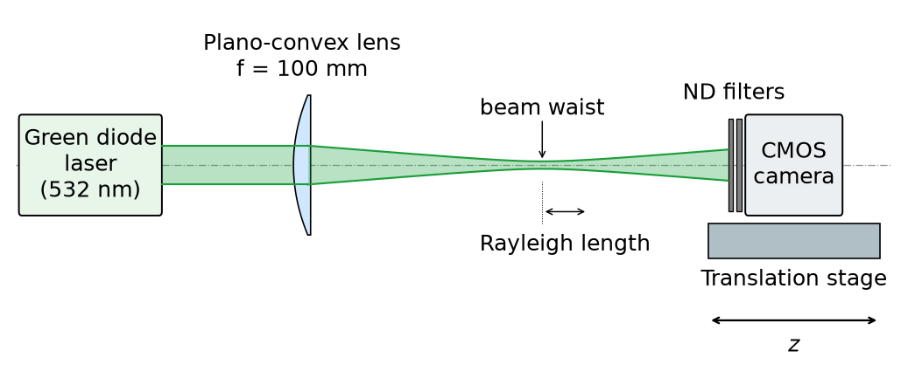

# ChemLab Automation

**Open-source Python & AI automation toolkit for chemical engineering simulations, laboratory electronics instrumentation, optical laser beam characterization, and reproducible lab reporting.**

[](LICENSE)
[](https://www.python.org/)
[](#modules)

Developed at the **University of Chemistry and Technology, Prague (UCT Prague / VŠCHT Praha)** — Faculty of Chemical Engineering (FCHI), combining real laboratory hardware control, numerical process modeling, and AI-agent workflow automation for academic research and teaching laboratories.

---

## Why This Project Exists

University chemical engineering and physical chemistry laboratories rely on a fragmented mix of benchtop electronics (Keithley DMMs, Thorlabs CMOS cameras), symbolic math worksheets (Maple), custom ODE solvers, and manual spreadsheet-to-DOCX report writing.

**ChemLab Automation** unifies these workflows into a modular, open-source Python ecosystem:
- **Hardware-timed instrument control** via USB-VISA and Keithley TSP scripting with real-time plotting and Tkinter GUI control.
- **Low-cost optical metrology** for ISO 11146 Gaussian laser beam characterization (beam waist, Rayleigh length, and M² caustic workflows).
- **Bioreactor & chemical engineering simulation** using SciPy ODE integration and Maple unit-operation models.
- **Portable AI-agent laboratory protocol automation** that enforces strict data integrity, uncertainty propagation, and academic typography standards when generating `.docx` lab reports from raw `.xlsx` experimental data.

---

## Modules

| Module | Focus Area | Key Stack | Entry Points |
| :--- | :--- | :--- | :--- |
| [`keithley-dmm6500/`](keithley-dmm6500/) | Benchtop electronics & DAQ automation (Keithley DMM6500) | `pyvisa`, `pyvisa-py`, TSP, `tkinter`, `matplotlib` | `src/gui_controller.py`, `src/dmm6500_logger.py`, `src/realtime_plot.py`, `src/analyze_intervals.py` |
| [`laser-beam-profiler/`](laser-beam-profiler/) | Bachelor's thesis & SVK low-cost ISO 11146 laser beam profiler (Thorlabs Zelux CS165MU/M + PT1/M) | `numpy`, `matplotlib`, ISO 11146 optics | `scripts/generate_optical_setup_diagram.py`, `scripts/math_unicode.py`, `docs/` |
| [`fermentor-cheming/`](fermentor-cheming/) | Bioreactor dissolved-O₂ mass-transfer ODE solver & ChemEng unit operations | `scipy.integrate.solve_ivp`, `numpy`, Maple (`.mw`, `.mpl`) | `fermentor_solver.py`, `fermentor3.mw`, `maple_cheming2/` |
| [`ai-lab-protocol-skill/`](ai-lab-protocol-skill/) | Portable AI agent skill for verified Czech/STEM lab report generation | `python-docx`, `openpyxl`, `matplotlib`, `SKILL.md` | `SKILL.md`, `scripts/read_xlsx.py`, `scripts/render_docx.py`, `scripts/validate_package.py` |
| [`scientific-python/`](scientific-python/) | Scientific computing, signal analysis & climate time-series ML pipeline | `scikit-learn`, `pandas`, `scipy`, `matplotlib` | `gloti_climate_forecast.py`, `s_plane_exponential.py`, `ode_projectile_solver.py` |

---

## Visual Preview — Low-Cost Laser Beam Profiler Setup

Generated directly from [`laser-beam-profiler/scripts/generate_optical_setup_diagram.py`](laser-beam-profiler/scripts/generate_optical_setup_diagram.py):



---

## Repository Structure

```text
chemlab-automation/
├── keithley-dmm6500/          # Keithley DMM6500 USB-VISA/TSP logger, GUI, live plot & timing jitter analysis
│   ├── src/
│   ├── experiments/
│   ├── environment.yml
│   └── setup_env.sh
├── laser-beam-profiler/       # Bachelor's thesis / SVK: low-cost ISO 11146 laser beam characterization
│   ├── scripts/
│   ├── docs/
│   └── assets/
├── fermentor-cheming/         # Bioreactor O2 mass-transfer ODE simulation & Maple ChemEng solvers
│   ├── fermentor_solver.py
│   ├── fermentor3.mw
│   └── maple_cheming2/
├── ai-lab-protocol-skill/     # Portable AI agent skill & Python DOCX/XLSX lab reporting pipeline
│   ├── SKILL.md
│   ├── agents/
│   ├── references/
│   └── scripts/
├── scientific-python/         # Climate ML forecasting (NASA GLOTI/ERA5), s-plane viewer & ODE tools
├── requirements.txt
├── CONTRIBUTING.md
└── LICENSE
```

---

## Quickstart

```bash
git clone https://github.com/marecek2005/chemlab-automation.git
cd chemlab-automation

python3 -m venv .venv
source .venv/bin/activate
pip install -r requirements.txt
```

### Run Individual Modules

```bash
# 1. Bioreactor dissolved oxygen ODE simulation (15 h batch fermentation)
python fermentor-cheming/fermentor_solver.py

# 2. Keithley DMM6500 GUI + hardware-timed TSP acquisition (requires USB-connected DMM6500)
python keithley-dmm6500/src/gui_controller.py

# 3. Analyze sampling interval jitter from recorded DMM6500 CSV data
python keithley-dmm6500/src/analyze_intervals.py

# 4. Regenerate the 532 nm laser caustic optical setup diagram
python laser-beam-profiler/scripts/generate_optical_setup_diagram.py

# 5. Interactive s-plane Re{e^(st)} control/signal systems explorer
python scientific-python/s_plane_exponential.py

# 6. Check environment readiness for the AI Lab Protocol skill
python ai-lab-protocol-skill/scripts/check_env.py
```

---

## Roadmap

- [ ] **Thorlabs Zelux CS165MU/M Python SDK integration**: Automated z-scan frame acquisition, dark-frame subtraction, and ISO 11146 `D4σ` beam-width + hyperbolic `M²` fitting pipeline.
- [ ] **Unified CLI (`chemlab`)**: Single command-line entry point for instrument logging, bioreactor simulation, and protocol validation.
- [ ] **Automated test suite (`pytest`)**: Synthetic VISA mock backend for CI testing of Keithley DMM6500 acquisition and CSV interval analysis without physical hardware.
- [ ] **English & LaTeX templates** for `ai-lab-protocol-skill` alongside existing Czech university typography rules.

---

## Contributing & License

Contributions are welcome — see [`CONTRIBUTING.md`](CONTRIBUTING.md).
This repository is released under the **[MIT License](LICENSE)**.
