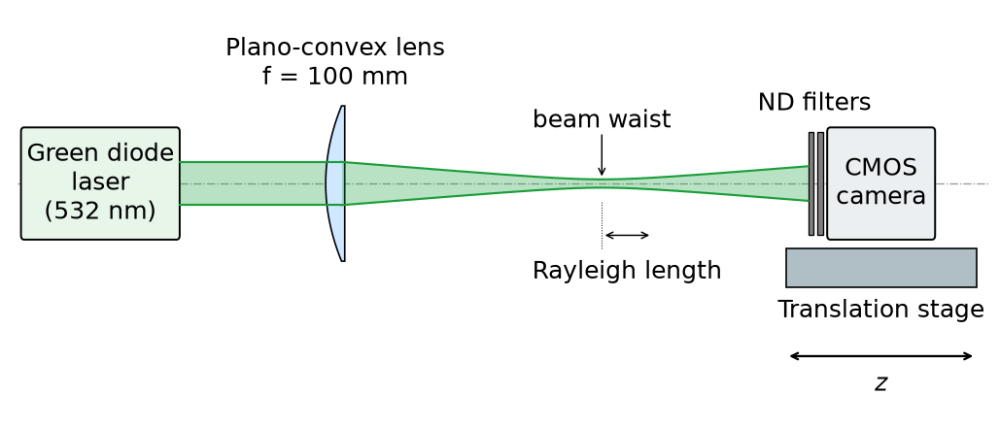

# Low-Cost Laser Beam Profiler (ISO 11146)

Software, optical schematics, and experimental measurement protocols developed for a **Bachelor's Thesis & Student Scientific Conference (SVK)** project at UCT Prague (Department of Physical Chemistry):

> **Development of Control Software for a Low-Cost Laser Beam Characterization Setup**

## Optical & Hardware Setup

- **Source**: 532 nm green compact diode laser module (Thorlabs CPS series)
- **Focusing Optics**: Plano-convex lens (`f = 100 mm`, Ø2″)
- **Attenuation**: Thorlabs `NEK01` absorptive neutral density (ND) filter kit
- **Detector**: Thorlabs Zelux `CS165MU/M` monochrome CMOS camera (1440 × 1080, 3.45 µm pixel pitch)
- **Translation**: Thorlabs `PT1/M` micrometer translation stage for axial caustic scanning



## Contents

- `scripts/generate_optical_setup_diagram.py`: Programmatic Matplotlib vector/raster diagram generator depicting the collimated 532 nm beam, plano-convex focusing lens, hyperbolic Gaussian caustic envelope (`w(z)`), beam waist (`w₀`), Rayleigh length (`z_R`), ND attenuation filters, and translation-stage camera.
- `scripts/math_unicode.py`: Lightweight LaTeX-to-Unicode converter for rendering physical optics equations cleanly in plain text, terminal outputs, and DOCX protocols without broken raw LaTeX delimiters.
- `assets/schema_setup.svg` & `assets/schema_setup.png`: Publication-ready optical setup diagrams.
- `docs/`:
  - `python_environment_plan_cs.md`: Planned Python software architecture for camera acquisition and caustic analysis.
  - `measurement_procedure_cs.md`: Step-by-step experimental procedure for axial beam profiling.
  - `experiment_protocol_cs.md`: Full experimental protocol covering ISO 11146 beam-width definitions (`D4σ`), hyperbolic waist/Rayleigh length fitting, and `M²` beam quality factor analysis.

## Running the Scripts

```bash
# Regenerate optical setup figures
python scripts/generate_optical_setup_diagram.py
```
